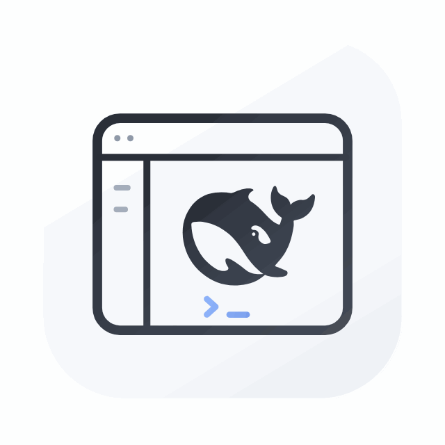
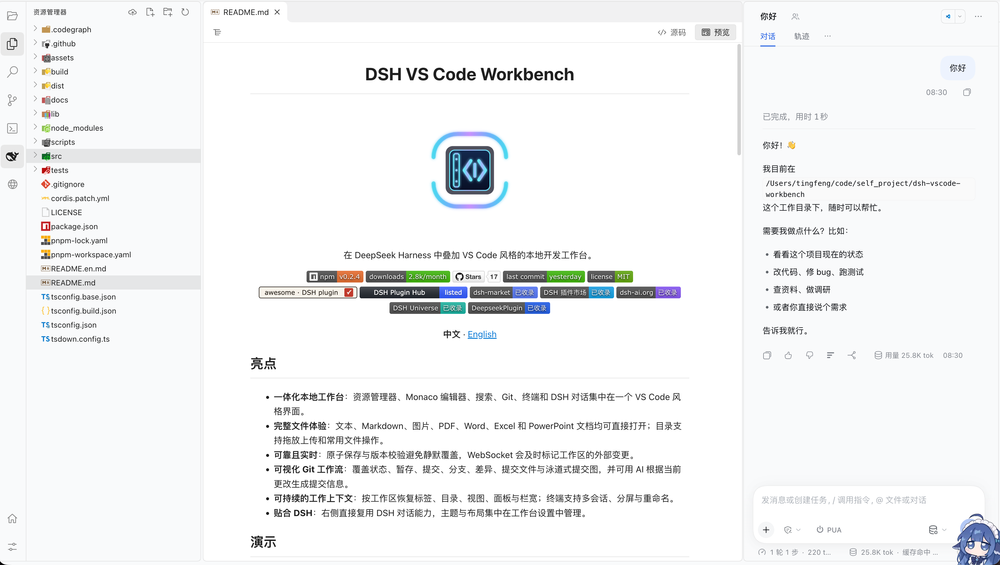
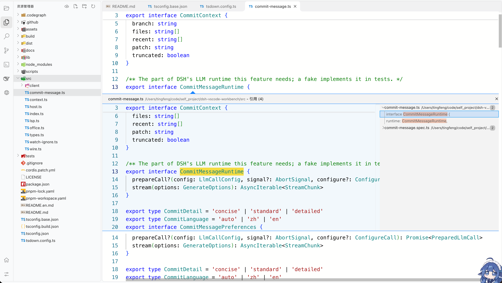
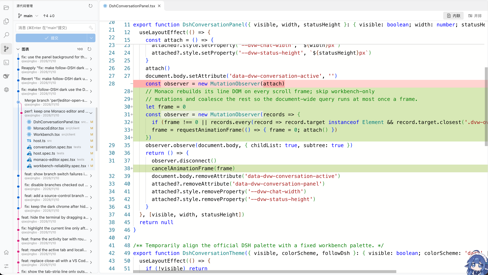

<p align="center">
  
</p>

<p align="center"><a href="README.md">中文</a> · English</p>

<p align="center"><strong>DSH VS Code Workbench</strong><br>
  A VS Code-style workspace for DeepSeek Harness with editing, search, Git, a terminal, and document and web previews.</p>

<p align="center">
  <a href="https://www.npmjs.com/package/dsh-vscode-workbench"></a>
  <a href="https://www.npmjs.com/package/dsh-vscode-workbench"></a>
  <a href="https://www.npmjs.com/package/dsh-vscode-workbench"></a>
  <a href="https://github.com/tingfeng347/dsh-vscode-workbench/stargazers"></a>
  <a href="https://github.com/tingfeng347/dsh-vscode-workbench/commits/main"></a>
  <a href="https://github.com/tingfeng347/dsh-vscode-workbench/blob/main/LICENSE"></a>
  <br>
  <a href="https://awesome-dsh-plugin.com/p/tingfeng347/dsh-vscode-workbench/"></a>
  <a href="https://dshpluginhub.ai/plugins/dsh-vscode-workbench"></a>
  <a href="https://dshmarket.com/p/tingfeng347/dsh-vscode-workbench/"></a>
  <a href="https://dshmk.com/plugins/1343926987"></a>
  <a href="https://dsh-ai.org/p/tingfeng347/dsh-vscode-workbench"></a>
  <a href="https://duink.com/plugins/1343926987/"></a>
  <a href="https://deepseekplugin.org/en/plugins/tingfeng347-dsh-vscode-workbench"></a>
</p>

## Installation

The plugin requires DeepSeek Harness `>=0.2.1-rc.1` at install time. The default test baseline is `0.2.3-alpha.2` (Cordis `4.2.0-alpha.1`).

```bash
npm i -g @deepseek-ai/dsh@0.2.3-alpha.2
dsh plugin --profile web add dsh-vscode-workbench
```

Installing from the DSH Plugins page or a marketplace enables the plugin automatically. After a CLI install, add `dsh-vscode-workbench` to `dsh.profile.bundles` in `~/.dsh/profiles/web/package.json` and restart `dsh web`. After it starts, open VS Code Workbench from the DSH sidebar. The plugin enables the official terminal and built-in browser. See [Installation](https://github.com/tingfeng347/dsh-vscode-workbench/blob/main/docs/INSTALL.en.md) for upgrades and Harness compatibility failures.

## Features

| Area | What you can do |
| --- | --- |
| Explorer | Create, rename, move, and delete files or folders. Upload by dropping files into the tree, drag files out to download, and select multiple entries to delete or copy relative or absolute paths. Open a file in a system app or reveal its location. |
| Editing and split panes | Use Monaco with syntax highlighting and Chinese menus. Drag a tab to an editor edge to split the view, or into another pane to move or swap files. The workbench restores tabs and layout per workspace, flags external file changes, and uses revision checks and atomic saves. |
| Language intelligence | Install a language server for TypeScript / JavaScript, Vue, or Python, or find manual setup instructions for C / C++, Go, Rust, and Java under DSH Settings → Workbench → Language Intelligence. Servers start when you open a matching file. Check their status or restart them in settings. Completion, auto imports, definition and reference previews, quick fixes, cross-file rename previews, formatting, and Problems depend on server capabilities. |
| Debugging | Open the Debug panel from the activity bar to set breakpoints, step through code, and inspect frames and variables. Node.js uses the built-in inspector. Python needs debugpy and C/C++ needs GDB with DAP support. |
| AI code completion | Choose Off, Manual, or Automatic under DSH Settings → Workbench → AI Code Completion. Off is the default. Follow the DSH chat model or pick a separate model. The model receives code around the cursor in the active file, including unsaved edits. |
| Documents and web pages | Switch between Markdown source and preview, and navigate with the outline. Preview images, PDFs, and Excel workbooks in tabs. LibreOffice converts Word and PowerPoint files to PDF for preview. Without LibreOffice, `.docx` can still preview in the browser. Web links and local HTML open in the built-in or system browser selected in settings. Use the Explorer context menu to edit HTML source. |
| Terminal and DSH chat | Use the official Harness terminal with multiple sessions, renaming, and splits. Add a selected file or folder from Explorer, or selected code from the editor, to DSH chat. Open generated file links for the current session in the workbench. |
| Workspaces and layout | Use the activity bar to open or create workspaces and create or switch sessions. Drag activity buttons to reorder them within each group. Home and Settings stay at the bottom. Resize the sidebars and terminal. Choose light, dark, pure white, or eye-care colors, or follow the DSH theme. Editor font size is configurable. |

Select Floating window under DSH Settings → Workbench → Window. Drag the title bar to move the window, drag an edge to resize it, or use the title bar button to enter fullscreen. The workbench remembers the position and size, which can be reset in settings.

### Workspace search and replace

Open Search in the sidebar and click the arrow beside the search box, or press `Ctrl+Shift+H` (`⌘⇧H` also works on macOS). Results are grouped by file. Select a match to reveal it in the editor.

- Use case-sensitive, whole-word, or regular-expression search. Open the search details menu to set include and exclude globs such as `src/**` and `**/*.test.ts`.
- Enter replacement text to preview deletions and additions. Replacement supports regex capture groups such as `$1` and a Preserve Case option. Replace one match, all matches in a file, or every result. File-wide and workspace-wide replacements ask for confirmation.
- An empty replacement field shows regular match highlighting. Clicking Replace with an empty field deletes the match. Save unsaved changes in target files first. If there are more than 2,000 matches, narrow the search before replacing in bulk.

### Git workflow

- **Source Control** supports staging, unstaging, discarding changes, committing, amending, and committing followed by push or sync. Click a staged file to compare `HEAD` with its staged content. Commits and amended commits refresh the commit graph before the operation finishes, so the new commit is visible when the action completes. AI can draft a commit message from the changes using the current DSH chat model or a model selected in settings. Choose the language and level of detail in settings, or stop generation and keep the draft.
- **The commit graph** expands to show changed files. Open a diff or preview an image or document from history. Hover over a commit for author, time, change statistics, and a copyable hash. The card links to GitHub when a known remote-tracking branch contains the commit. Drag the divider between Changes and Graph to resize, or double-click to reset it.
- Choose the **VS Code or IDEA / PyCharm diff style** under DSH Settings → Workbench → Git. Diff views support change navigation and folding of unchanged lines. The workbench remembers the inline or side-by-side selection. In the side-by-side ribbon view, the right pane follows the left in the same frame, and guides extend into both panes. Blue means modified, green added, and red deleted. Click a line in a file or diff to see its commit attribution.
- Open Source Control → **Git Tools** to filter commit or file history, compare branches, tags, commits, or tracked working tree files, cherry-pick or revert commits, and manage stashes, local branches, and tags. Fetch, fast-forward pull, push, merge, and rebase from the sync view. In the conflict view, inspect all three versions, take a side, or edit and stage the merged result.

### AI change review

In DSH Settings → Workbench → AI Change Review, choose to review all changes or only the latest task. Review is off by default. Once enabled, review individual blocks in Monaco, review a file from the editor toolbar, or act on all pending files above the DSH chat input. Auto-follow can reveal new changes once you stop interacting.

Accepting keeps changes already written by the AI. Rejecting attempts to restore the affected content and reports conflicts. Review covers edits made by DSH file tools. See [AI change review](https://github.com/tingfeng347/dsh-vscode-workbench/blob/main/docs/features/ai-review.md) for details in Chinese.

## Demo

<p align="center">
  
  <br><em>Explorer, Markdown preview, terminal, and DSH conversation</em>
</p>

<p align="center">
  
  <br><em>Find references with Peek results in the editor</em>
</p>

<p align="center">
  
  <br><em>Source control, commit graph, and inline/split diffs</em>
</p>

<p align="center">
  
  <br><em>IDEA / PyCharm side-by-side diff with change connectors, folding, and navigation</em>
</p>

<p align="center">
  
  <br><em>Start a terminal or open the browser from the empty editor</em>
</p>

<p align="center">
  
  <br><em>Workbench settings inside DSH for theme, font size, window, and layout</em>
</p>

<p align="center">
  
  <br><em>Open a workspace, switch sessions, or create a new workspace</em>
</p>

## Shortcuts

| Shortcut | Action |
| --- | --- |
| `Ctrl+Shift+E` | Open Explorer |
| `Ctrl+Shift+F` / `⌘⇧F` | Search the workspace |
| `Ctrl+Shift+H` / `⌘⇧H` | Open workspace replace |
| `Ctrl+Shift+G` | Open Source Control |
| `Ctrl/Cmd+Click` | Toggle one Explorer item |
| `Shift+Click` | Select the visible range from the anchor |
| `Ctrl/Cmd+A` | Select every visible Explorer item |
| `Shift+Up/Down` | Extend or shrink the contiguous selection |
| `Ctrl/Cmd+C` | Copy selected relative paths, one per line |
| `Delete` / `Backspace` | Delete selected Explorer items |
| `Esc` | Clear the selection or close the delete confirmation |
| `Ctrl+S` / `⌘S` | Save the active file |
| `Ctrl+Alt+B` | Toggle the DSH conversation panel |
| `` Ctrl+` `` | Show or hide the terminal |
| `` Ctrl+Shift+` `` | Create a terminal |
| `Ctrl+T` / `⌘T` | Open a built-in browser tab |
| `Ctrl/Cmd+Alt+K` | Add the current file or selected code to DSH chat from the editor |
| `Alt/Option+\` | Trigger AI code completion when enabled |
| `Tab` / `Esc` | Accept or dismiss an AI inline suggestion |
| `Ctrl/Cmd+Enter` | Commit from the commit message field |
| `F11` / `Ctrl+Command+F` | Toggle floating-window fullscreen (second shortcut on macOS) |

## Security

All plugin routes require Harness authentication. The host accepts only paths relative to the active DSH session workspace and rejects traversal and symlink escape. Saves use revision checks and atomic replacement. Git and ripgrep run with argument arrays rather than shell-concatenated commands. Terminals use the official Harness controller, connection authentication and execution environment. Credential filtering belongs to the official subprocess provider.

## Development

```bash
pnpm install
pnpm typecheck
pnpm test
pnpm build
```

Requires Node.js `^22.19 || >=24`, pnpm 11.7 and system Git. The workbench no longer installs its own native terminal module.

## Docs

- [Architecture](https://github.com/tingfeng347/dsh-vscode-workbench/blob/main/docs/ARCHITECTURE.en.md): mounting, DSH services, and Harness compatibility.
- [Installation](https://github.com/tingfeng347/dsh-vscode-workbench/blob/main/docs/INSTALL.en.md): CLI and marketplace installs, terminal prerequisites, upgrades, and troubleshooting.
- [Explorer multi-select](https://github.com/tingfeng347/dsh-vscode-workbench/blob/main/docs/features/explorer-multiselect.md) · [Monaco localization](https://github.com/tingfeng347/dsh-vscode-workbench/blob/main/docs/features/localization.md) (Chinese)
- [Changelog](https://github.com/tingfeng347/dsh-vscode-workbench/blob/main/docs/CHANGELOG.md) (Chinese) · [GitHub releases](https://github.com/tingfeng347/dsh-vscode-workbench/releases)
- [Release checklist](https://github.com/tingfeng347/dsh-vscode-workbench/blob/main/docs/RELEASE-CHECKLIST.md): validation and packaging steps.

## License

[MIT](LICENSE)
