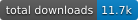
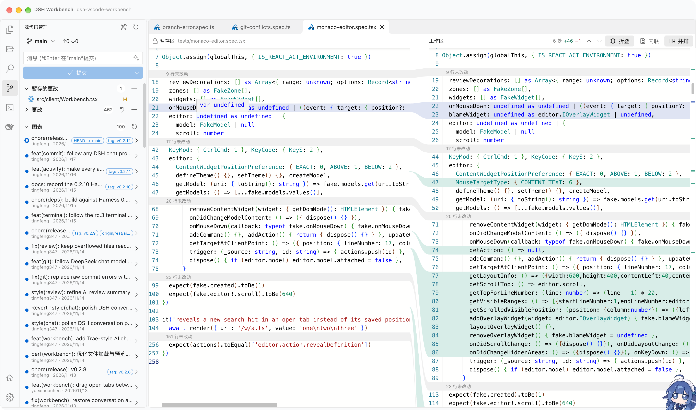
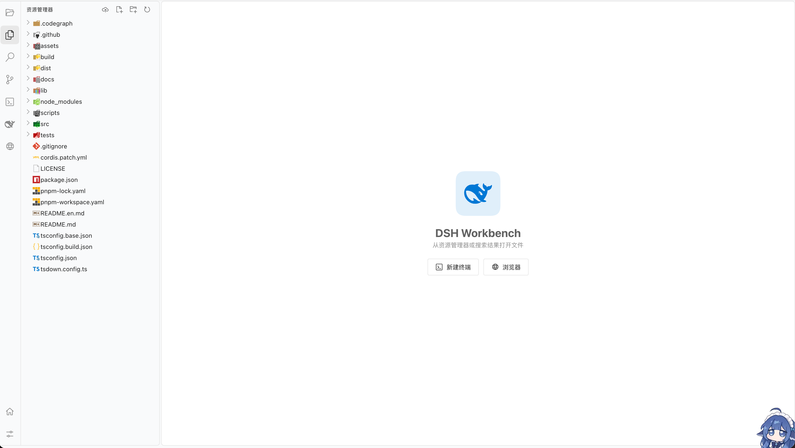
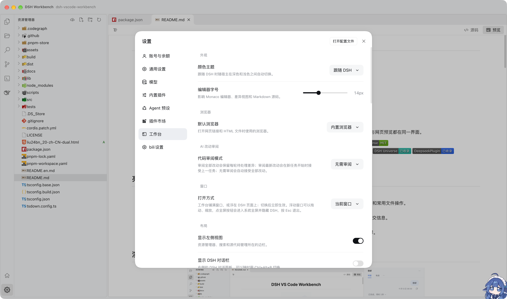
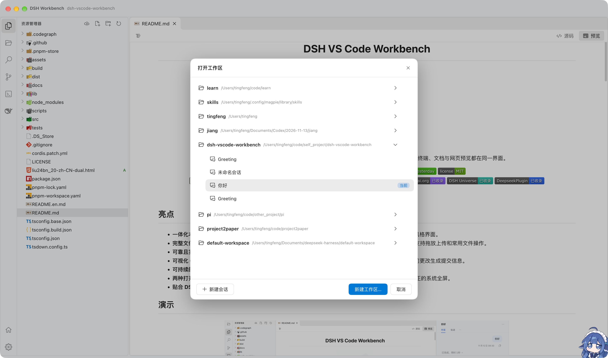

<p align="center">
  
</p>

<p align="center"><a href="README.md">中文</a> · English</p>

<p align="center"><strong>DSH VS Code Workbench</strong><br>
  A VS Code-style workspace for DeepSeek Harness with editing, search, Git, remote SSH development, a terminal, and document and web previews.</p>

<p align="center">
  <a href="https://www.npmjs.com/package/dsh-vscode-workbench"></a>
  <a href="https://www.npmjs.com/package/dsh-vscode-workbench"></a>
  <a href="https://www.npmjs.com/package/dsh-vscode-workbench"></a>
  <a href="https://github.com/tingfeng347/dsh-vscode-workbench/stargazers"></a>
  <a href="https://github.com/tingfeng347/dsh-vscode-workbench/commits/main"></a>
  <a href="https://github.com/tingfeng347/dsh-vscode-workbench/blob/main/LICENSE"></a>
  <br>
  <a href="https://awesome-dsh-plugin.com/p/tingfeng347/dsh-vscode-workbench/"></a>
  <a href="https://dshpluginhub.ai/plugins/dsh-vscode-workbench"></a>
  <a href="https://dshmarket.com/p/tingfeng347/dsh-vscode-workbench/"></a>
  <a href="https://dshmk.com/plugins/1343926987"></a>
  <a href="https://dsh-ai.org/p/tingfeng347/dsh-vscode-workbench"></a>
  <a href="https://duink.com/plugins/1343926987/"></a>
  <a href="https://deepseekplugin.org/en/plugins/tingfeng347-dsh-vscode-workbench"></a>
</p>

## Installation

Install the npm `latest` version of DeepSeek Harness. The plugin requires Harness `>=0.2.1-rc.1`.

```bash
npm i -g @deepseek-ai/dsh@latest
dsh plugin --profile web add dsh-vscode-workbench
```

Installing from the DSH Plugins page or a marketplace enables the plugin automatically. After a CLI install, add `dsh-vscode-workbench` to `dsh.profile.bundles` in `~/.dsh/profiles/web/package.json` and restart `dsh web`. After it starts, open VS Code Workbench from the DSH sidebar. The plugin enables the official terminal and built-in browser. See [Installation](https://github.com/tingfeng347/dsh-vscode-workbench/blob/main/docs/INSTALL.en.md) for upgrades and Harness compatibility failures.

## Features

| Area | What you can do |
| --- | --- |
| Files and editing | Create, rename, move, delete, and drag files, with multi-selection, split panes, Monaco editing, and per-workspace layout restoration. Saves use revision checks and atomic writes. |
| Workspace search and replace | Search with case, whole-word, regular-expression, and include or exclude path options. Preview and replace one match, one file, or all results. |
| Git and file review | Stage, commit, amend, push, and sync from Source Control. Compare staged files with `HEAD` and browse the automatically refreshed commit graph. Change blocks in split diffs can add a file reference with the affected lines to the DSH conversation. IDEA / PyCharm split diffs are the default, with VS Code inline diffs available as an alternative. |
| Language intelligence and debugging | Install and restart language servers for completion, definitions, references, fixes, formatting, and Problems. The Debug panel supports breakpoints, stepping, call stacks, and variables. |
| AI assistance | Use Off, Manual, or Automatic code completion. Review all or the latest AI changes by block, file, or batch, with optional auto-follow. |
| Remote SSH development | Connect with an OpenSSH alias or address using ssh-agent, a private key, or a password. Edit, download, and drag and drop remote files. Use search and replace, Git, and the terminal. The SSH selector below the DSH composer switches between connected workspaces and supports remote file and line references. |
| Documents and web pages | Preview Markdown, images, PDFs, Excel, Word, and PowerPoint in tabs, and open web links or local HTML in the built-in or system browser. |
| Terminal and DSH chat | Use the official Harness terminal with multiple sessions, renaming, and splits. Add files or editor selections to DSH chat and open generated file links from the current session. The workbench chat remains the default; use the official conversation header actions to open it in the sidebar or editor. |
| Workspaces, layout, and window | Manage workspaces and sessions, arrange the activity bar, sidebars, chat, terminal, themes, and font size. The editor supports half and quarter-screen drops; when files are open, chat leaves one quarter of the editor area available, and it can fill an empty editor area otherwise. Floating windows support dragging, resizing, fullscreen, and remembered geometry. |

### Conversations and layout

- In the official conversation header's `…` menu, choose **Open conversation in editor** to open the current session as an editor tab. The same menu can move it back to the sidebar or close the conversation panel.
- Conversation tabs, file tabs, and Explorer files can be dropped on any editor edge for half- or quarter-screen groups; dropping in the center moves the item into the current editor group.
- The official browser and its start page remain in the official right sidebar instead of being redirected into workbench editor tabs. An empty editor group can open a workspace or be closed.

## Demo

<p align="center">
  
  <br><em>Explorer, Markdown preview, terminal, and DSH conversation</em>
</p>

<p align="center">
  
  <br><em>Find references with Peek results in the editor</em>
</p>

<p align="center">
  
  <br><em>Source control, commit graph, and inline/split diffs</em>
</p>

<p align="center">
  
  <br><em>IDEA / PyCharm side-by-side diff with change connectors, folding, and navigation</em>
</p>

<p align="center">
  
  <br><em>Legacy welcome-page screenshot (for reference only)</em>
</p>

<p align="center">
  
  <br><em>Workbench settings inside DSH for theme, font size, window, and layout</em>
</p>

<p align="center">
  
  <br><em>Open a workspace, switch sessions, or create a new workspace</em>
</p>

## Shortcuts

| Shortcut | Action |
| --- | --- |
| `Ctrl+Shift+E` | Open Explorer |
| `Ctrl+Shift+F` / `⌘⇧F` | Search the workspace |
| `Ctrl+Shift+H` / `⌘⇧H` | Open workspace replace |
| `Ctrl+Shift+G` | Open Source Control |
| `Ctrl/Cmd+Click` | Toggle one Explorer item |
| `Shift+Click` | Select the visible range from the anchor |
| `Ctrl/Cmd+A` | Select every visible Explorer item |
| `Shift+Up/Down` | Extend or shrink the contiguous selection |
| `Ctrl/Cmd+C` | Copy selected relative paths, one per line |
| `Delete` / `Backspace` | Delete selected Explorer items |
| `Esc` | Clear the selection or close the delete confirmation |
| `Ctrl+S` / `⌘S` | Save the active file |
| `Ctrl+Alt+B` | Toggle the DSH conversation panel |
| `` Ctrl+` `` | Show or hide the terminal |
| `` Ctrl+Shift+` `` | Create a terminal |
| `Ctrl+T` / `⌘T` | Open the official browser |
| `Ctrl/Cmd+Alt+K` | Add the current file or selected code to DSH chat from the editor |
| `Alt/Option+\` | Trigger AI code completion when enabled |
| `Tab` / `Esc` | Accept or dismiss an AI inline suggestion |
| `Ctrl/Cmd+Enter` | Commit from the commit message field |
| `F11` / `Ctrl+Command+F` | Toggle floating-window fullscreen (second shortcut on macOS) |

## Security

All plugin routes require Harness authentication. The host accepts only paths relative to the active DSH session workspace and rejects traversal and symlink escape. Saves use revision checks and atomic replacement. Git and ripgrep run with argument arrays rather than shell-concatenated commands. Remote SSH uses the local OpenSSH client with optional password storage in the system credential store. On Linux, password storage requires Secret Service. File operations validate paths against the remote workspace with `realpath`. Remote commands in chat start in the selected workspace and run with the SSH account permissions. Terminals use the official Harness controller, connection authentication and execution environment. Credential filtering belongs to the official subprocess provider.

## Development

```bash
pnpm install
pnpm typecheck
pnpm test
pnpm build
```

Requires Node.js `^22.19 || >=24`, pnpm 11.7 and system Git. The workbench no longer installs its own native terminal module.

## Docs

- [Architecture](https://github.com/tingfeng347/dsh-vscode-workbench/blob/main/docs/ARCHITECTURE.en.md): extension points, host services, compatibility, and source layout.
- [Installation](https://github.com/tingfeng347/dsh-vscode-workbench/blob/main/docs/INSTALL.en.md): CLI and marketplace installs, terminal prerequisites, upgrades, and troubleshooting.
- [Official terminal and browser](https://github.com/tingfeng347/dsh-vscode-workbench/blob/main/docs/features/native-tools.md) (Chinese) · [Data protection and recovery](https://github.com/tingfeng347/dsh-vscode-workbench/blob/main/docs/features/reliability.md) (Chinese)
- [Explorer multi-select](https://github.com/tingfeng347/dsh-vscode-workbench/blob/main/docs/features/explorer-multiselect.md) · [Monaco localization](https://github.com/tingfeng347/dsh-vscode-workbench/blob/main/docs/features/localization.md) · [AI change review](https://github.com/tingfeng347/dsh-vscode-workbench/blob/main/docs/features/ai-review.md) (Chinese)
- [Changelog](https://github.com/tingfeng347/dsh-vscode-workbench/blob/main/docs/CHANGELOG.md) (Chinese) · [GitHub releases](https://github.com/tingfeng347/dsh-vscode-workbench/releases)
- [Release checklist](https://github.com/tingfeng347/dsh-vscode-workbench/blob/main/docs/maintenance/release-checklist.md): validation and packaging steps.

## License

[MIT](LICENSE)
