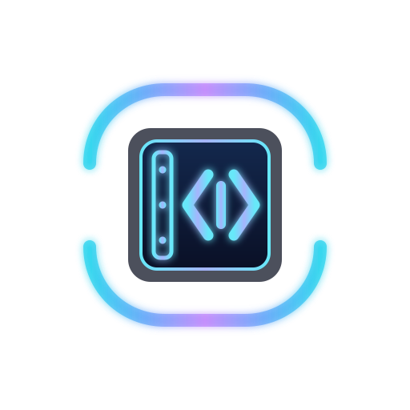
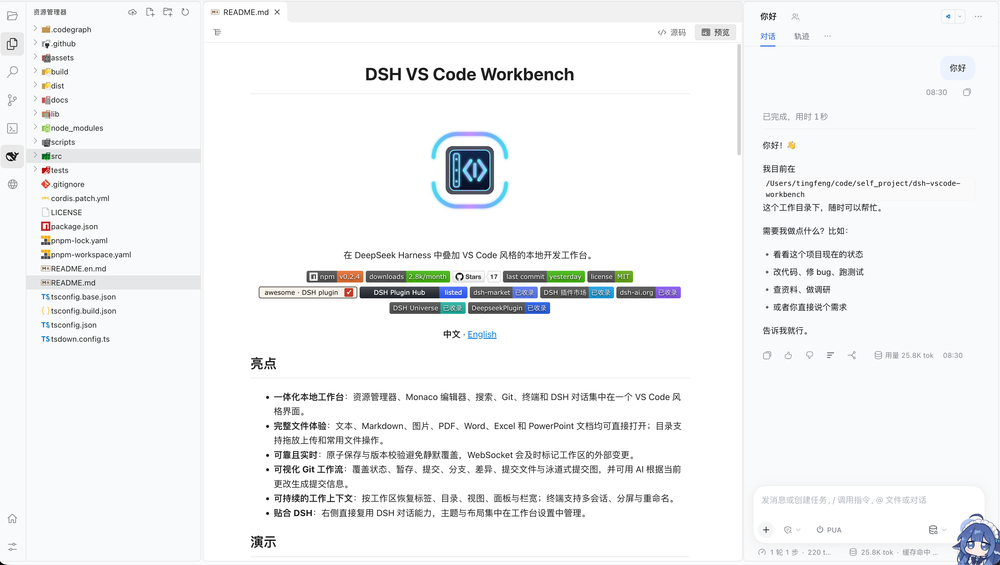
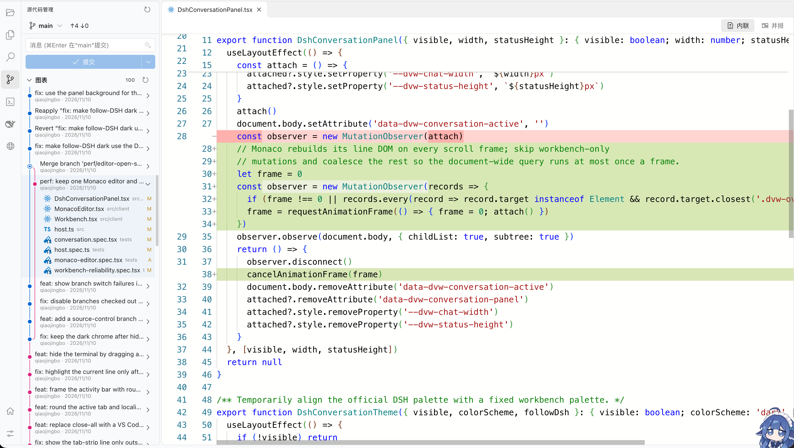
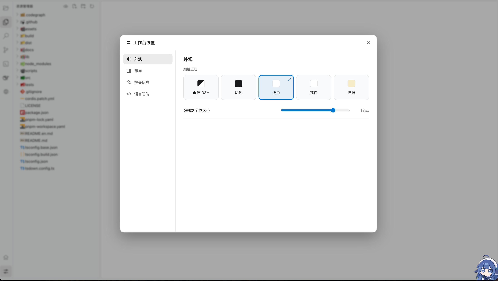

<h1 align="center">DSH VS Code Workbench</h1>

<p align="center">
  
</p>

<p align="center">A VS Code-style local development workbench for DeepSeek Harness.</p>

<p align="center">
  <a href="https://www.npmjs.com/package/dsh-vscode-workbench"></a>
  <a href="https://www.npmjs.com/package/dsh-vscode-workbench"></a>
  <a href="https://github.com/tingfeng347/dsh-vscode-workbench/stargazers"></a>
  <a href="https://github.com/tingfeng347/dsh-vscode-workbench/commits/main"></a>
  <a href="https://github.com/tingfeng347/dsh-vscode-workbench/blob/main/LICENSE"></a>
  <br>
  <a href="https://awesome-dsh-plugin.com/p/tingfeng347/dsh-vscode-workbench/"></a>
  <a href="https://dshpluginhub.ai/plugins/dsh-vscode-workbench"></a>
  <a href="https://dshmarket.com/p/tingfeng347/dsh-vscode-workbench/"></a>
  <a href="https://dshmk.com/plugins/1343926987"></a>
  <a href="https://dsh-ai.org/p/tingfeng347/dsh-vscode-workbench"></a>
  <a href="https://duink.com/plugins/1343926987/"></a>
  <a href="https://deepseekplugin.org/en/plugins/tingfeng347-dsh-vscode-workbench"></a>
</p>

<p align="center"><a href="README.md">中文</a> · <b>English</b></p>

## Highlights

- **One local workbench**: explorer, Monaco editor, search, Git, terminal, and DSH conversation in one VS Code-style interface.
- **Complete file experience**: open text, Markdown, images, PDF, Word, Excel, and PowerPoint files directly; the tree supports drag-and-drop uploads and common file operations.
- **Reliable and live**: atomic saves and revision checks prevent silent overwrites, while WebSocket updates flag external workspace changes.
- **Visual Git workflow**: status, staging, commits, branches, diffs, commit files, a swimlane commit graph, and AI-generated commit messages from the current changes.
- **Persistent workspace context**: restore tabs, tree, views, panels, and widths per workspace; terminals support multiple sessions, splits, and rename.
- **Built for DSH**: reuse the DSH conversation surface on the right and manage theme and layout from workbench settings.

## Demo

<p align="center">
  
  <br><em>Explorer, Monaco editor, terminal, and DSH conversation</em>
</p>

<p align="center">
  
  <br><em>Source control, AI commit message, and commit graph</em>
</p>

<p align="center">
  
  <br><em>Language intelligence and language server management</em>
</p>

## Installation

Plugin 0.2.4 targets DeepSeek Harness `0.2.2-rc.1` (Cordis `4.1.0`). Update Harness before installing:

```bash
npm i -g @deepseek-ai/dsh@0.2.2-rc.1
dsh plugin --profile web add dsh-vscode-workbench
```

Installing from the DSH Plugins page or a marketplace enables the plugin automatically. After a CLI install, add `dsh-vscode-workbench` to `dsh.profile.bundles` in `~/.dsh/profiles/web/package.json` and restart `dsh web`. The terminal depends on `node-pty`; see [Installation](https://github.com/tingfeng347/dsh-vscode-workbench/blob/main/docs/INSTALL.en.md) for blocked build scripts, upgrades, and Harness compatibility failures.

## Shortcuts

| Shortcut | Action |
| --- | --- |
| `Ctrl+Shift+E` | Open Explorer |
| `Ctrl+Shift+F` | Open Search |
| `Ctrl+Shift+G` | Open Source Control |
| `Ctrl+S` | Save the active file |
| `Ctrl+Alt+B` | Toggle the DSH conversation panel |
| `Ctrl+\`` | Show or hide the terminal |
| `Ctrl+Shift+\`` | Create a terminal |

## Security

All plugin routes require Harness authentication. The host accepts only paths relative to the active DSH session workspace and rejects traversal and symlink escape. Saves use revision checks and atomic replacement. Git and ripgrep run with argument arrays rather than shell-concatenated commands. The terminal accepts same-origin loopback requests only, stays in the session workspace selected at creation, and removes API keys, tokens, secrets, and similar environment variables.

## Development

```bash
pnpm install
pnpm typecheck
pnpm test
pnpm build
```

Requires Node.js `^22.19 || >=24`, pnpm 11.7, system Git, and the native build prerequisites for `node-pty` when no prebuild is available.

## Docs

- [Architecture](https://github.com/tingfeng347/dsh-vscode-workbench/blob/main/docs/ARCHITECTURE.en.md): mounting, DSH services, and Harness compatibility.
- [Installation](https://github.com/tingfeng347/dsh-vscode-workbench/blob/main/docs/INSTALL.en.md): CLI and marketplace installs, terminal prerequisites, upgrades, and troubleshooting.
- [Changelog](https://github.com/tingfeng347/dsh-vscode-workbench/releases): release notes.
- [Release checklist](https://github.com/tingfeng347/dsh-vscode-workbench/blob/main/docs/RELEASE-CHECKLIST.md): validation and packaging steps.

## License

[MIT](LICENSE)
