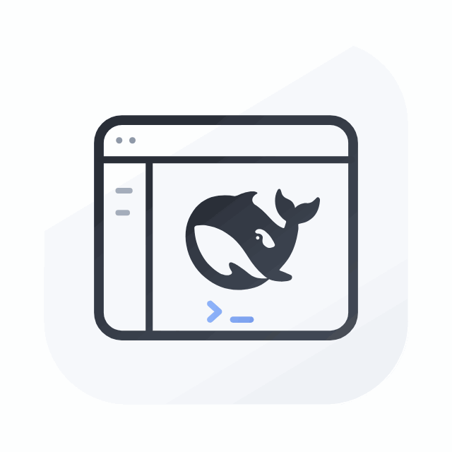
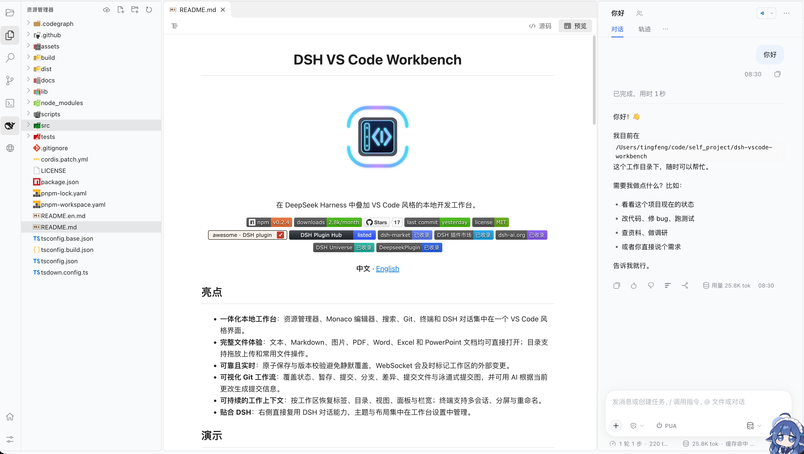
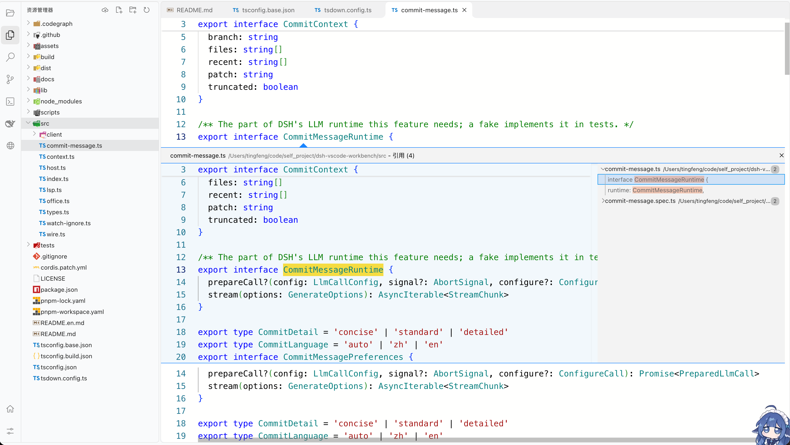
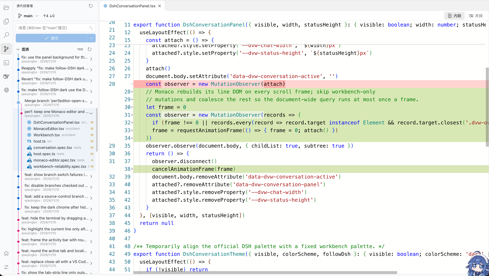
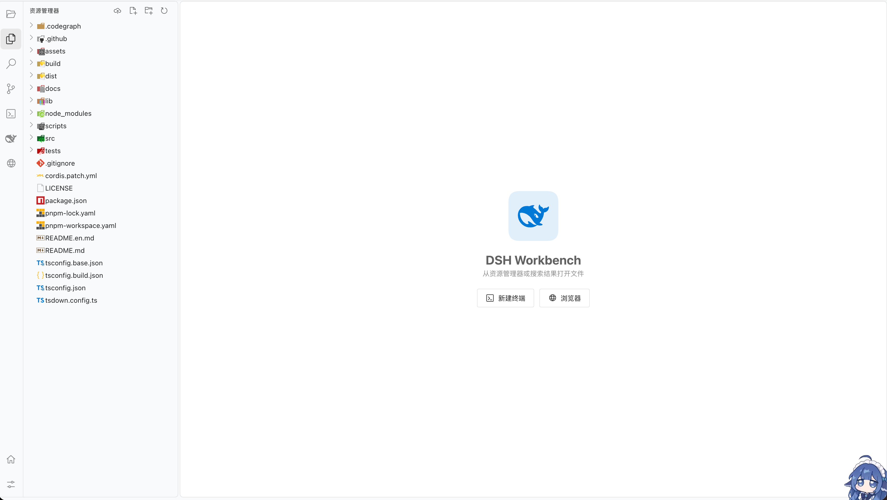
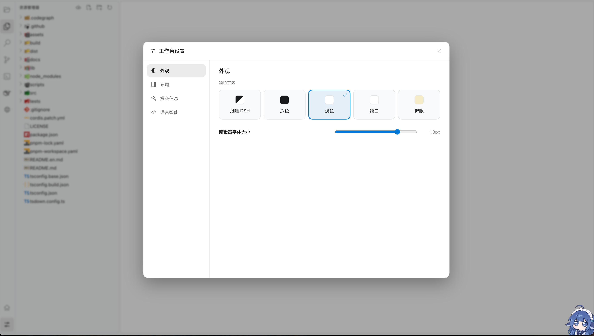
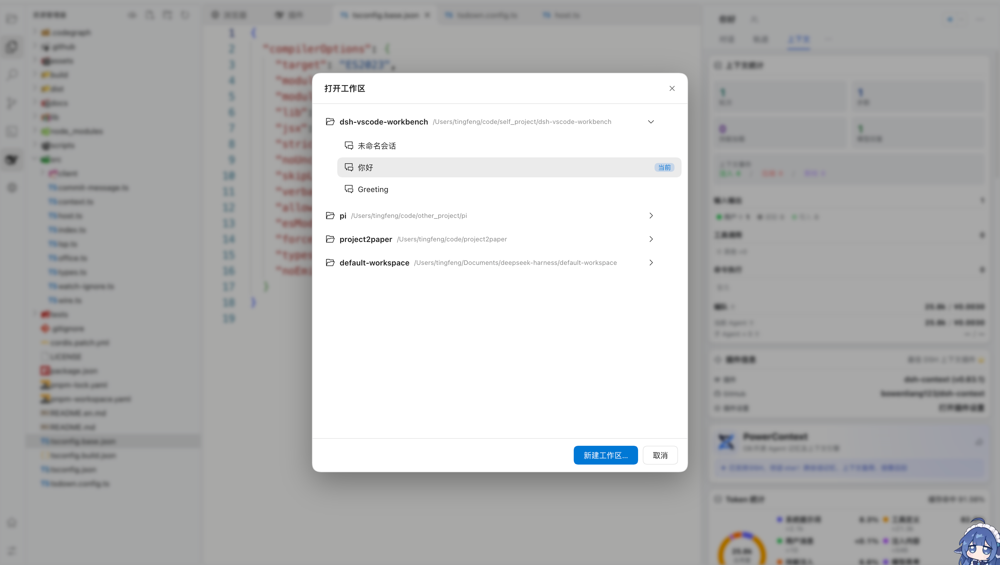

<h1 align="center">DSH VS Code Workbench</h1>

<p align="center">
  
</p>

<p align="center">在 DeepSeek Harness 里开一个 VS Code 风格的本地工作台：编辑、搜索、Git、终端、文档与网页预览都在同一界面。</p>

<p align="center">
  <a href="https://www.npmjs.com/package/dsh-vscode-workbench"></a>
  <a href="https://www.npmjs.com/package/dsh-vscode-workbench"></a>
  <a href="https://github.com/tingfeng347/dsh-vscode-workbench/stargazers"></a>
  <a href="https://github.com/tingfeng347/dsh-vscode-workbench/commits/main"></a>
  <a href="https://github.com/tingfeng347/dsh-vscode-workbench/blob/main/LICENSE"></a>
  <br>
  <a href="https://awesome-dsh-plugin.com/p/tingfeng347/dsh-vscode-workbench/"></a>
  <a href="https://dshpluginhub.ai/plugins/dsh-vscode-workbench"></a>
  <a href="https://dshmarket.com/p/tingfeng347/dsh-vscode-workbench/"></a>
  <a href="https://dshmk.com/plugins/1343926987"></a>
  <a href="https://dsh-ai.org/p/tingfeng347/dsh-vscode-workbench"></a>
  <a href="https://duink.com/plugins/1343926987/"></a>
  <a href="https://deepseekplugin.org/plugins/tingfeng347-dsh-vscode-workbench"></a>
</p>

<p align="center"><b>中文</b> · <a href="README.en.md">English</a></p>

## 亮点

- **一体化本地工作台**：资源管理器、Monaco 编辑器、搜索、Git、终端和 DSH 对话集中在一个 VS Code 风格界面。
- **完整文件体验**：文本、Markdown、图片、PDF、Word、Excel 和 PowerPoint 文档均可直接打开；目录支持拖放上传和常用文件操作。
- **可靠且实时**：原子保存与版本校验避免静默覆盖，WebSocket 会及时标记工作区的外部变更。
- **可视化 Git 工作流**：覆盖状态、暂存、提交、分支、差异、提交文件与泳道式提交图，并可用 AI 根据当前更改生成提交信息。
- **可持续的工作上下文**：按工作区恢复标签、目录、视图、面板与栏宽；终端支持多会话、分屏与重命名。
- **两种打开方式**：工作台可以铺满窗口，也可以作为浮动窗口覆盖在 DSH 之上，支持拖动、八向缩放和真正的系统全屏。
- **贴合 DSH**：右侧直接复用 DSH 对话能力，主题与布局集中在 DSH 设置的 Workbench 页。

## 演示

<p align="center">
  
  <br><em>资源管理器、Markdown 预览、终端与 DSH 对话</em>
</p>

<p align="center">
  
  <br><em>编辑器内查找引用与 Peek 结果</em>
</p>

<p align="center">
  
  <br><em>源代码管理、提交图与内联/并排差异</em>
</p>

<p align="center">
  
  <br><em>空编辑器可直接新建终端或打开浏览器</em>
</p>

<p align="center">
  
  <br><em>设置直接开在 DSH 官方设置里：主题、字号、布局、提交信息与语言服务</em>
</p>

<p align="center">
  
  <br><em>打开工作区、切换会话与新建工作区</em>
</p>

## 安装

插件 0.2.7 支持 DeepSeek Harness `0.2.1-rc.1` 及以上（默认验证基线 `0.2.2-rc.1`，Cordis `4.1.0`）。Harness 低于 `0.2.1-rc.1` 时会被安装闸门拒绝：

```bash
npm i -g @deepseek-ai/dsh@0.2.2-rc.1
dsh plugin --profile web add dsh-vscode-workbench
```

通过 DSH 插件页或插件市场安装会自动启用。用 CLI 安装后还需在 `~/.dsh/profiles/web/package.json` 的 `dsh.profile.bundles` 中加入 `dsh-vscode-workbench`，再重启 `dsh web`。终端直接使用 Harness 官方服务，普通浏览器也随工作台启用，无需另装终端或侧栏插件。升级旧版或遇到 Harness 版本不兼容，见[安装与升级](https://github.com/tingfeng347/dsh-vscode-workbench/blob/main/docs/INSTALL.md)。

## 快捷键

| 快捷键 | 操作 |
| --- | --- |
| `Ctrl+Shift+E` | 打开资源管理器 |
| `Ctrl+Shift+F` | 打开搜索 |
| `Ctrl+Shift+G` | 打开源代码管理 |
| `Ctrl+S` | 保存当前文件 |
| `Ctrl+Alt+B` | 显示或隐藏 DSH 对话栏 |
| `Ctrl+\`` | 显示或隐藏终端 |
| `Ctrl+Shift+\`` | 新建终端 |
| `F11` / `Ctrl+Command+F` | 浮动窗口进入或退出全屏（后者用于 macOS） |

左侧活动栏的终端按钮可切换底部面板。打开网页链接或 HTML 文件时会按设置里的「默认浏览器」在官方浏览器标签或系统浏览器中打开；`Cmd+T`（macOS）或 `Ctrl+T` 新建浏览器。终端保留右侧列表、重命名和分屏。升级前运行的旧终端不能迁移，更新后请新建终端。

在 DSH 设置 → Workbench → 窗口里把「打开方式」改成「浮动窗口」后，工作台会以内嵌浮层出现在 DSH 页面上，对话和侧栏仍然露在外面：拖标题栏移动、拖边缘缩放。点标题栏的全屏按钮或双击标题栏会调用浏览器 Fullscreen API，让工作台独占整个屏幕并隐藏 DSH 标题栏、侧栏和对话；按 `Esc`、全屏按钮或 `F11`（macOS 也可用 `Ctrl+Command+F`）退出。位置和大小会被记住，设置里的「重置位置与大小」可以随时恢复默认。它复用 DSH 现有的原生窗口，不是新的系统窗口。

## 安全

所有插件接口要求 Harness 登录认证。Host 只接受当前 DSH 会话工作目录内的相对路径，并阻止目录穿越与符号链接越界。保存使用版本校验与原子替换；Git 与 ripgrep 使用参数数组启动，不拼接 Shell 命令。终端使用 Harness 官方控制器、连接认证和执行环境，在 Session 当前工作目录启动；凭据环境变量过滤由官方 subprocess provider 负责。

## 开发

```bash
pnpm install
pnpm typecheck
pnpm test
pnpm build
```

需要 Node.js `^22.19 || >=24`、pnpm 11.7 和系统 Git。工作台不再单独安装终端原生模块。

## 文档

- [架构适配](https://github.com/tingfeng347/dsh-vscode-workbench/blob/main/docs/ARCHITECTURE.md)：挂载方式、DSH 服务接入与版本兼容范围。
- [安装与升级](https://github.com/tingfeng347/dsh-vscode-workbench/blob/main/docs/INSTALL.md)：CLI 与插件市场安装、终端依赖、旧版升级和排错。
- [版本记录](https://github.com/tingfeng347/dsh-vscode-workbench/blob/main/docs/CHANGELOG.md)：0.1.11 起的版本变化。
- [发布检查](https://github.com/tingfeng347/dsh-vscode-workbench/blob/main/docs/RELEASE-CHECKLIST.md)：发布前的验证与打包步骤。

## 许可证

[MIT](LICENSE)
