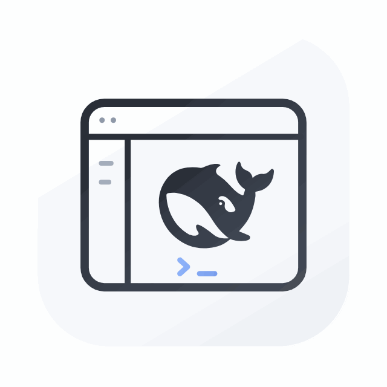
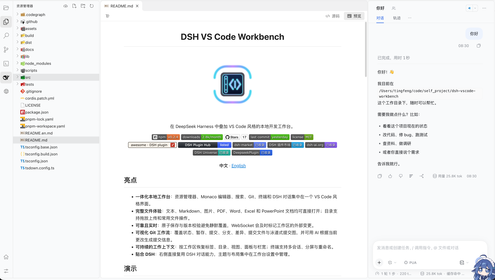
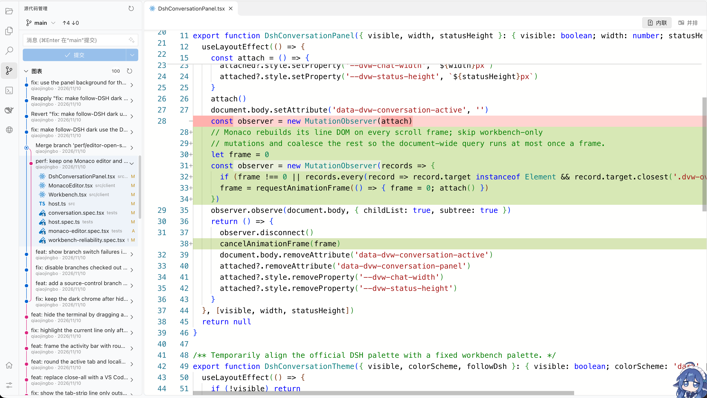
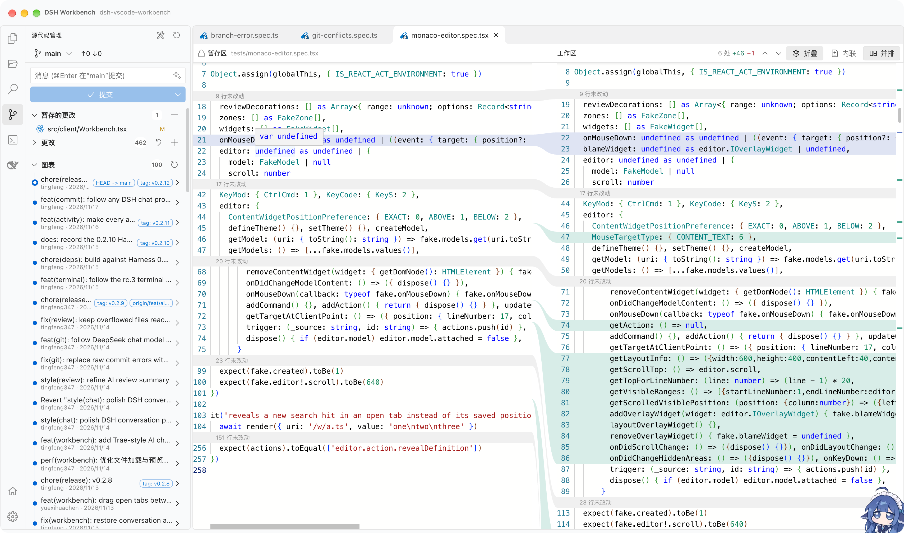
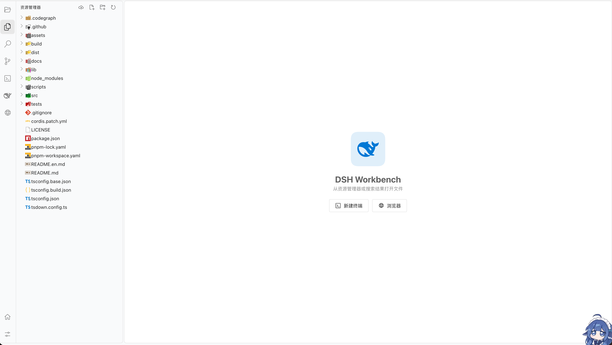
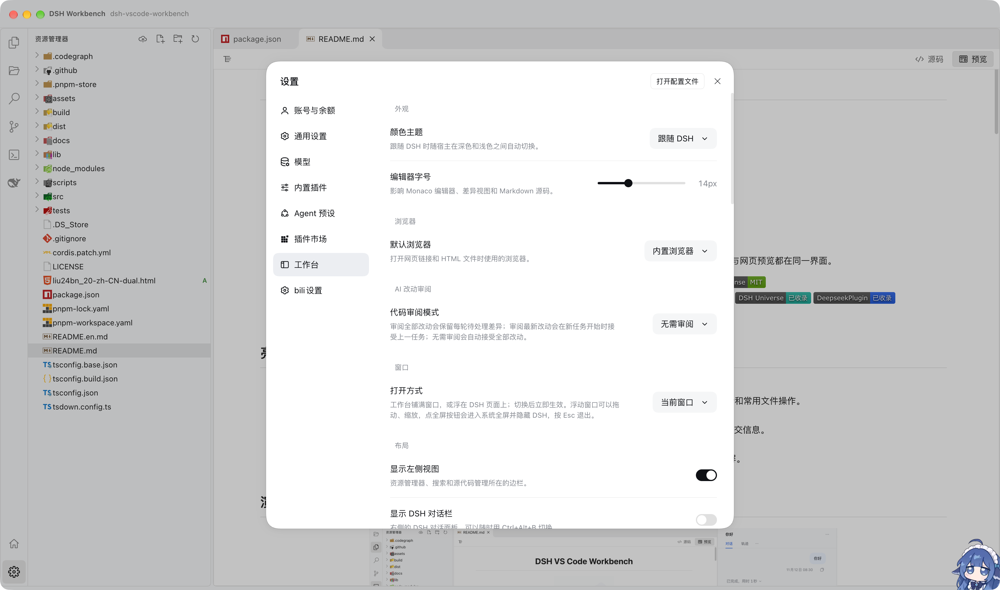
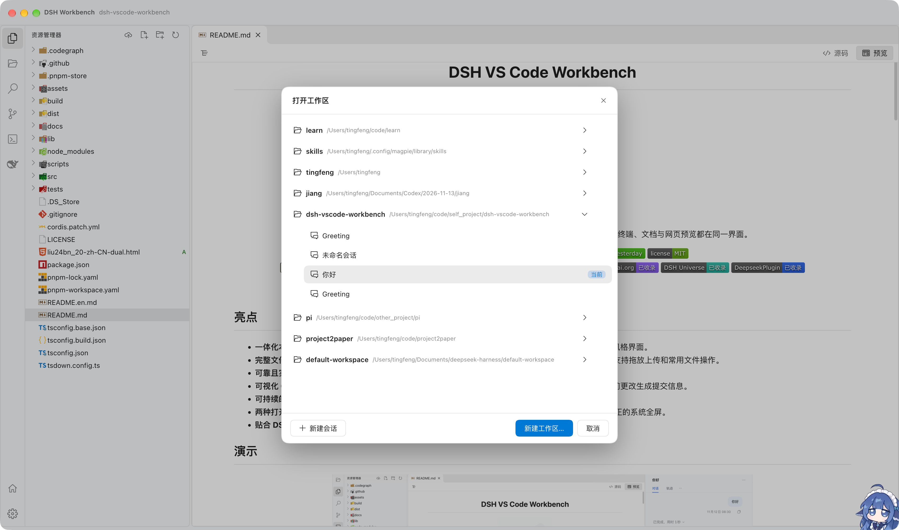

<p align="center">
  
</p>

<p align="center">中文 · <a href="README.en.md">English</a></p>

<p align="center"><strong>DSH VS Code Workbench</strong><br>
  DeepSeek Harness 里的 VS Code 风格工作台，集成编辑、搜索、Git、终端、文档与网页预览。</p>

<p align="center">
  <a href="https://www.npmjs.com/package/dsh-vscode-workbench"></a>
  <a href="https://www.npmjs.com/package/dsh-vscode-workbench"></a>
  <a href="https://www.npmjs.com/package/dsh-vscode-workbench"></a>
  <a href="https://github.com/tingfeng347/dsh-vscode-workbench/stargazers"></a>
  <a href="https://github.com/tingfeng347/dsh-vscode-workbench/commits/main"></a>
  <a href="https://github.com/tingfeng347/dsh-vscode-workbench/blob/main/LICENSE"></a>
  <br>
  <a href="https://awesome-dsh-plugin.com/p/tingfeng347/dsh-vscode-workbench/"></a>
  <a href="https://dshpluginhub.ai/plugins/dsh-vscode-workbench"></a>
  <a href="https://dshmarket.com/p/tingfeng347/dsh-vscode-workbench/"></a>
  <a href="https://dshmk.com/plugins/1343926987"></a>
  <a href="https://dsh-ai.org/p/tingfeng347/dsh-vscode-workbench"></a>
  <a href="https://duink.com/plugins/1343926987/"></a>
  <a href="https://deepseekplugin.org/plugins/tingfeng347-dsh-vscode-workbench"></a>
</p>

## 安装

插件的安装版本要求是 DeepSeek Harness `>=0.2.1-rc.1`，当前验证基线为 `0.2.2-rc.5`（Cordis `4.1.0`）。

```bash
npm i -g @deepseek-ai/dsh@0.2.2-rc.5
dsh plugin --profile web add dsh-vscode-workbench
```

通过 DSH 插件页或插件市场安装会自动启用。用 CLI 安装后还需在 `~/.dsh/profiles/web/package.json` 的 `dsh.profile.bundles` 中加入 `dsh-vscode-workbench`，再重启 `dsh web`。启动后，从 DSH 侧栏打开「VS Code 工作台」。官方终端和内置浏览器随插件启用。升级旧版或遇到 Harness 版本不兼容，见[安装与升级](https://github.com/tingfeng347/dsh-vscode-workbench/blob/main/docs/INSTALL.md)。

## 功能概览

| 功能 | 可以做什么 |
| --- | --- |
| 资源管理器 | 新建、重命名、移动和删除文件或目录。支持拖放上传、文件拖出下载、多选批量删除、复制相对或绝对路径，也能用系统应用打开文件或显示文件位置。 |
| 编辑与分屏 | Monaco 编辑器支持语法高亮和中文菜单。拖标签到编辑区边缘创建分屏，拖到另一窗格移动或交换文件。工作台按工作区恢复标签和布局。编辑器会提示文件的外部修改，保存时校验版本并原子写入。 |
| 语言智能 | 在「DSH 设置 → 工作台 → 语言智能」安装 TypeScript / JavaScript、Vue 或 Python 的语言服务，或查看 C / C++、Go、Rust、Java 语言服务的手动安装说明。服务按打开的文件启动，设置页可查看状态并重启。支持智能补全、自动导入、定义和引用预览、快速修复、跨文件重命名预览、格式化和问题面板，具体功能取决于语言服务器。 |
| 文档与网页 | Markdown 支持源码、预览和大纲。图片、PDF 和 Excel 等表格可在标签页预览。Word 和 PowerPoint 可通过 LibreOffice 转成 PDF 预览，未安装时 `.docx` 仍可在浏览器内预览。网页链接和本地 HTML 用设置里选定的内置或系统浏览器打开。右键 HTML 文件可选「打开 HTML 源码」。 |
| 终端与 DSH 对话 | 使用 Harness 官方终端，支持多会话、重命名和分屏。可从资源管理器把选中的单个文件或目录添加到 DSH 对话，也可在编辑器中添加选中的代码。点击当前会话中的生成文件链接可在工作台打开对应文件。 |
| 工作区与布局 | 从活动栏进入工作区切换器，可打开或新建工作区、创建或切换会话。活动栏可拖动排序，侧栏、对话栏和终端区域可调整尺寸。设置支持跟随 DSH、深色、浅色、纯白和护眼主题，可调整编辑器字号。 |

在「DSH 设置 → 工作台 → 窗口」中选择「浮动窗口」，可拖动标题栏移动、拖边缘缩放，或用标题栏按钮进入全屏。位置和尺寸会被记住，可在设置中重置。

## 工作区搜索与替换

打开侧栏「搜索」，点击搜索框左侧箭头展开替换，或按 `Ctrl+Shift+H`（macOS 也可用 `⌘⇧H`）。结果按文件分组，点击匹配项可跳到编辑器内的对应位置。

- 搜索支持区分大小写、全字匹配和正则表达式。点击「…」可填写包含和排除路径，例如 `src/**` 和 `**/*.test.ts`。
- 输入替换文字后，可预览删除和新增内容。替换支持正则捕获组（如 `$1`）及「保留大小写」。可替换单处、单个文件或全部结果，文件级和全部替换会先确认。
- 替换框为空时只显示普通搜索高亮，主动点击替换会删除对应匹配。目标文件有未保存的修改时，请先保存。超过 2,000 处匹配时，请缩小搜索范围再批量替换。

## Git 工作流

- **源代码管理**支持暂存、取消暂存、放弃修改、提交、修改上次提交、提交后推送或同步。AI 可根据工作区改动生成提交信息，默认使用当前 DSH 对话模型，也可在设置中指定模型、语言和详细程度。点击停止可取消生成并保留草稿。
- **提交图**可展开每次提交的改动文件，点击文件可打开差异，支持从历史预览图片和文档。悬停在提交上可查看作者、时间、改动统计并复制哈希。已知的 GitHub 远程跟踪分支包含该提交时，卡片也会提供 GitHub 链接。「更改」和「图表」之间的分隔线可拖动，双击恢复默认高度。
- 在「DSH 设置 → 工作台 → Git」可选择 **VS Code 或 IDEA / PyCharm 差异样式**。差异视图支持改动导航、折叠未改动行，并记住内联或并排选择。飘带式并排视图中，滚动左栏时右栏同帧跟随。蓝色表示修改、绿色表示新增、红色表示删除，定位线延伸到两侧。点击编辑器或差异视图里的代码行，可在行尾查看提交归属。
- 从「源代码管理 → Git 工具」可筛选提交和文件历史，比较分支、标签、提交或工作区的已跟踪文件，拣选或撤销提交，管理 Stash 和本地分支、标签。同步页支持抓取、仅快进拉取、推送、合并和变基。冲突页可查看三方内容、采纳一侧或编辑、保存并暂存合并结果。

## AI 改动审阅

在「DSH 设置 → 工作台 → AI 改动审阅」选择「审阅全部改动」或「审阅最新改动」。审阅默认关闭，开启后可在 Monaco 中逐块处理、在编辑器顶部按文件处理，或在 DSH 输入框上方一次处理全部待审阅文件。可启用「自动跟随 AI 修改」，在操作停下后定位到新改动。

接受会保留 AI 已写入的内容。拒绝会尝试还原对应改动，遇到内容冲突时会提示。审阅针对 DSH 文件工具的改动，详见 [AI 改动审阅](https://github.com/tingfeng347/dsh-vscode-workbench/blob/main/docs/features/ai-review.md)。

## 演示

<p align="center">
  
  <br><em>资源管理器、Markdown 预览、终端与 DSH 对话</em>
</p>

<p align="center">
  
  <br><em>编辑器内查找引用与 Peek 结果</em>
</p>

<p align="center">
  
  <br><em>源代码管理、提交图与内联/并排差异</em>
</p>

<p align="center">
  
  <br><em>IDEA / PyCharm 并排差异，带改动连线、折叠和差异导航</em>
</p>

<p align="center">
  
  <br><em>空编辑器可直接新建终端或打开浏览器</em>
</p>

<p align="center">
  
  <br><em>DSH 内的工作台设置，包括主题、编辑器字号、窗口和布局</em>
</p>

<p align="center">
  
  <br><em>打开工作区、切换会话与新建工作区</em>
</p>

## 快捷键

| 快捷键 | 操作 |
| --- | --- |
| `Ctrl+Shift+E` | 打开资源管理器 |
| `Ctrl+Shift+F` / `⌘⇧F` | 打开工作区搜索 |
| `Ctrl+Shift+H` / `⌘⇧H` | 展开工作区替换，可按匹配项、文件或全部结果替换 |
| `Ctrl+Shift+G` | 打开源代码管理 |
| `Ctrl/⌘+点击` | 在资源管理器中切换单个项目的选中状态 |
| `Shift+点击` | 连续选择从锚点到当前项目的可见条目 |
| `Ctrl/⌘+A` | 选择资源管理器当前可见的全部项目 |
| `Shift+↑/↓` | 按可见顺序扩展或收缩连续选择 |
| `Ctrl/⌘+C` | 复制选中项目的相对路径，每行一个 |
| `Delete` / `Backspace` | 删除资源管理器中的选中项目 |
| `Esc` | 清空资源管理器多选或关闭删除确认 |
| `Ctrl+S` / `⌘S` | 保存当前文件 |
| `Ctrl+Alt+B` | 显示或隐藏 DSH 对话栏 |
| `` Ctrl+` `` | 显示或隐藏终端 |
| `` Ctrl+Shift+` `` | 新建终端 |
| `Ctrl+T` / `⌘T` | 新建内置浏览器标签 |
| `Ctrl/⌘+Alt+K` | 将当前文件或选中的代码添加到 DSH 对话（编辑器内） |
| `Ctrl/⌘+Enter` | 从提交消息框提交 |
| `F11` / `Ctrl+Command+F` | 浮动窗口进入或退出全屏（后者用于 macOS） |

## 安全

所有插件接口要求 Harness 登录认证。Host 只接受当前 DSH 会话工作目录内的相对路径，并阻止目录穿越与符号链接越界。保存使用版本校验与原子替换；Git 与 ripgrep 使用参数数组启动，不拼接 Shell 命令。终端使用 Harness 官方控制器、连接认证和执行环境，在 Session 当前工作目录启动；凭据环境变量过滤由官方 subprocess provider 负责。

## 开发

```bash
pnpm install
pnpm typecheck
pnpm test
pnpm build
```

需要 Node.js `^22.19 || >=24`、pnpm 11.7 和系统 Git。工作台不再单独安装终端原生模块。

## 文档

- [架构适配](https://github.com/tingfeng347/dsh-vscode-workbench/blob/main/docs/ARCHITECTURE.md)：挂载方式、DSH 服务接入与版本兼容范围。
- [安装与升级](https://github.com/tingfeng347/dsh-vscode-workbench/blob/main/docs/INSTALL.md)：CLI 与插件市场安装、终端依赖、旧版升级和排错。
- [资源管理器多选](https://github.com/tingfeng347/dsh-vscode-workbench/blob/main/docs/features/explorer-multiselect.md) · [Monaco 中文补全](https://github.com/tingfeng347/dsh-vscode-workbench/blob/main/docs/features/localization.md)
- [版本记录](https://github.com/tingfeng347/dsh-vscode-workbench/blob/main/docs/CHANGELOG.md)：0.1.11 起的版本变化。
- [发布检查](https://github.com/tingfeng347/dsh-vscode-workbench/blob/main/docs/RELEASE-CHECKLIST.md)：发布前的验证与打包步骤。

## 许可证

[MIT](LICENSE)
