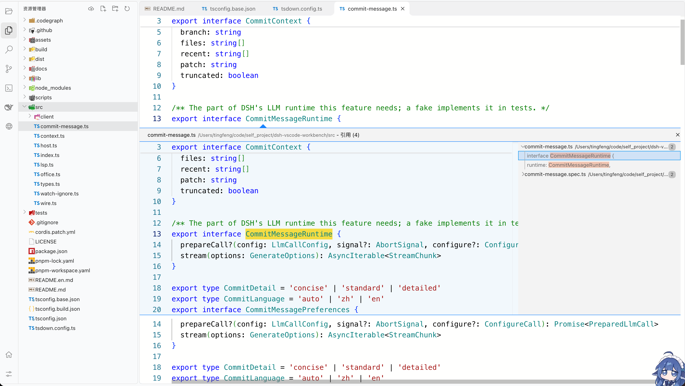

<p align="center">
  
</p>

<p align="center">中文 · <a href="README.en.md">English</a></p>

<p align="center"><strong>DSH VS Code Workbench</strong><br>
  DeepSeek Harness 里的 VS Code 风格工作台，集成编辑、搜索、Git、SSH 远程开发、终端、文档与网页预览。</p>

<p align="center">
  <a href="https://www.npmjs.com/package/dsh-vscode-workbench"></a>
  <a href="https://www.npmjs.com/package/dsh-vscode-workbench"></a>
  <a href="https://www.npmjs.com/package/dsh-vscode-workbench"></a>
  <a href="https://github.com/tingfeng347/dsh-vscode-workbench/stargazers"></a>
  <a href="https://github.com/tingfeng347/dsh-vscode-workbench/commits/main"></a>
  <a href="https://github.com/tingfeng347/dsh-vscode-workbench/blob/main/LICENSE"></a>
  <br>
  <a href="https://awesome-dsh-plugin.com/p/tingfeng347/dsh-vscode-workbench/"></a>
  <a href="https://dshpluginhub.ai/plugins/dsh-vscode-workbench"></a>
  <a href="https://dshmarket.com/p/tingfeng347/dsh-vscode-workbench/"></a>
  <a href="https://dshmk.com/plugins/1343926987"></a>
  <a href="https://dsh-ai.org/p/tingfeng347/dsh-vscode-workbench"></a>
  <a href="https://duink.com/plugins/1343926987/"></a>
  <a href="https://deepseekplugin.org/plugins/tingfeng347-dsh-vscode-workbench"></a>
</p>

## 安装

插件的安装版本要求是 DeepSeek Harness `>=0.2.1-rc.1`，当前默认验证基线为 `0.2.2-rc.5`（Cordis `4.1.0`），并完成 Harness `0.2.3` 的路由认证适配。

```bash
npm i -g @deepseek-ai/dsh@0.2.2-rc.5
dsh plugin --profile web add dsh-vscode-workbench
```

通过 DSH 插件页或插件市场安装会自动启用。用 CLI 安装后还需在 `~/.dsh/profiles/web/package.json` 的 `dsh.profile.bundles` 中加入 `dsh-vscode-workbench`，再重启 `dsh web`。启动后，从 DSH 侧栏打开「VS Code 工作台」。官方终端和内置浏览器随插件启用。升级旧版或遇到 Harness 版本不兼容，见[安装与升级](https://github.com/tingfeng347/dsh-vscode-workbench/blob/main/docs/INSTALL.md)。

## 功能概览

| 功能 | 可以做什么 |
| --- | --- |
| 文件与编辑 | 新建、重命名、移动、删除和拖放文件，支持批量选择、分屏和 Monaco 编辑，并按工作区恢复布局。保存时校验版本并原子写入。 |
| 工作区搜索与替换 | 支持区分大小写、全字匹配、正则、包含或排除路径，并可预览后替换单处、单个文件或全部结果。 |
| Git 与文件审核 | 源代码管理支持暂存、提交、修改提交、推送和同步。暂存文件可按 `HEAD ↔ 暂存区` 对比，提交后自动刷新图表。并排差异的变更块可将对应行作为引用添加到 DSH 对话。默认使用 IDEA / PyCharm 并排差异，也可切回 VS Code 内联样式。 |
| 语言智能与调试 | 按语言安装和重启语言服务，使用补全、定义、引用、修复、格式化与问题面板。调试面板支持断点、单步、调用栈和变量。 |
| AI 辅助 | 提供关闭、手动和自动三种代码补全模式。可审阅全部或最新 AI 改动，逐块、按文件或批量处理，并自动跟随新改动。 |
| SSH 远程开发 | 从 `~/.ssh/config` 或手动填写主机，使用本机 OpenSSH、ssh-agent、密钥或一次性密码连接。支持远程文件编辑、搜索替换、Git 暂存与提交、差异对比和远程终端。 |
| 文档与网页 | 在标签页预览 Markdown、图片、PDF、Excel、Word 和 PowerPoint，并用内置或系统浏览器打开网页与本地 HTML。 |
| 终端与 DSH 对话 | 使用官方 Harness 终端的多会话、重命名和分屏，可从文件或编辑器向 DSH 添加内容，并打开会话中的生成文件链接。 |
| 工作区、布局与窗口 | 管理 Workspace 和 Session，调整活动栏、侧栏、对话栏与终端布局及主题字号。浮动窗口支持拖动、缩放、全屏，并记住位置和尺寸。 |

## 演示

<p align="center">
  
  <br><em>资源管理器、Markdown 预览、终端与 DSH 对话</em>
</p>

<p align="center">
  
  <br><em>编辑器内查找引用与 Peek 结果</em>
</p>

<p align="center">
  
  <br><em>源代码管理、提交图与内联/并排差异</em>
</p>

<p align="center">
  
  <br><em>IDEA / PyCharm 并排差异，带改动连线、折叠和差异导航</em>
</p>

<p align="center">
  
  <br><em>空编辑器可直接新建终端或打开浏览器</em>
</p>

<p align="center">
  
  <br><em>DSH 内的工作台设置，包括主题、编辑器字号、窗口和布局</em>
</p>

<p align="center">
  
  <br><em>打开工作区、切换会话与新建工作区</em>
</p>

## 快捷键

| 快捷键 | 操作 |
| --- | --- |
| `Ctrl+Shift+E` | 打开资源管理器 |
| `Ctrl+Shift+F` / `⌘⇧F` | 打开工作区搜索 |
| `Ctrl+Shift+H` / `⌘⇧H` | 展开工作区替换，可按匹配项、文件或全部结果替换 |
| `Ctrl+Shift+G` | 打开源代码管理 |
| `Ctrl/⌘+点击` | 在资源管理器中切换单个项目的选中状态 |
| `Shift+点击` | 连续选择从锚点到当前项目的可见条目 |
| `Ctrl/⌘+A` | 选择资源管理器当前可见的全部项目 |
| `Shift+↑/↓` | 按可见顺序扩展或收缩连续选择 |
| `Ctrl/⌘+C` | 复制选中项目的相对路径，每行一个 |
| `Delete` / `Backspace` | 删除资源管理器中的选中项目 |
| `Esc` | 清空资源管理器多选或关闭删除确认 |
| `Ctrl+S` / `⌘S` | 保存当前文件 |
| `Ctrl+Alt+B` | 显示或隐藏 DSH 对话栏 |
| `` Ctrl+` `` | 显示或隐藏终端 |
| `` Ctrl+Shift+` `` | 新建终端 |
| `Ctrl+T` / `⌘T` | 新建内置浏览器标签 |
| `Ctrl/⌘+Alt+K` | 将当前文件或选中的代码添加到 DSH 对话（编辑器内） |
| `Alt/Option+\` | 手动触发 AI 代码补全（启用后） |
| `Tab` / `Esc` | 接受或隐藏 AI 行内建议 |
| `Ctrl/⌘+Enter` | 从提交消息框提交 |
| `F11` / `Ctrl+Command+F` | 浮动窗口进入或退出全屏（后者用于 macOS） |

## 安全

所有插件接口要求 Harness 登录认证。Host 只接受当前 DSH 会话工作目录内的相对路径，并阻止目录穿越与符号链接越界。保存使用版本校验与原子替换；Git 与 ripgrep 使用参数数组启动，不拼接 Shell 命令。SSH 使用本机 OpenSSH，密码只保留在连接内存中，并在远端通过 `realpath` 再次校验路径位于连接时确认的工作区根目录内。终端使用 Harness 官方控制器、连接认证和执行环境，在 Session 当前工作目录启动；凭据环境变量过滤由官方 subprocess provider 负责。

## 开发

```bash
pnpm install
pnpm typecheck
pnpm test
pnpm build
```

需要 Node.js `^22.19 || >=24`、pnpm 11.7 和系统 Git。工作台不再单独安装终端原生模块。

## 文档

- [架构适配](https://github.com/tingfeng347/dsh-vscode-workbench/blob/main/docs/ARCHITECTURE.md)：挂载方式、DSH 服务接入与版本兼容范围。
- [安装与升级](https://github.com/tingfeng347/dsh-vscode-workbench/blob/main/docs/INSTALL.md)：CLI 与插件市场安装、终端依赖、旧版升级和排错。
- [资源管理器多选](https://github.com/tingfeng347/dsh-vscode-workbench/blob/main/docs/features/explorer-multiselect.md) · [Monaco 中文补全](https://github.com/tingfeng347/dsh-vscode-workbench/blob/main/docs/features/localization.md)
- [版本记录](https://github.com/tingfeng347/dsh-vscode-workbench/blob/main/docs/CHANGELOG.md)：0.1.11 起的版本变化。
- [发布检查](https://github.com/tingfeng347/dsh-vscode-workbench/blob/main/docs/RELEASE-CHECKLIST.md)：发布前的验证与打包步骤。

## 许可证

[MIT](LICENSE)
