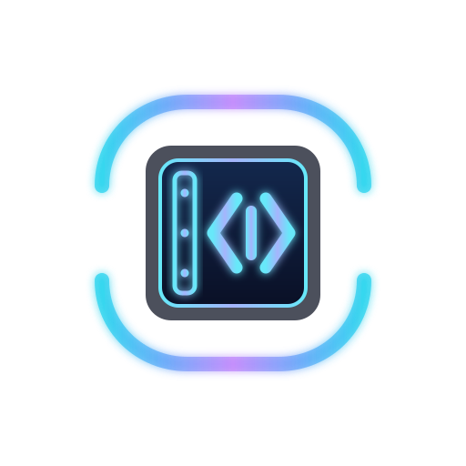
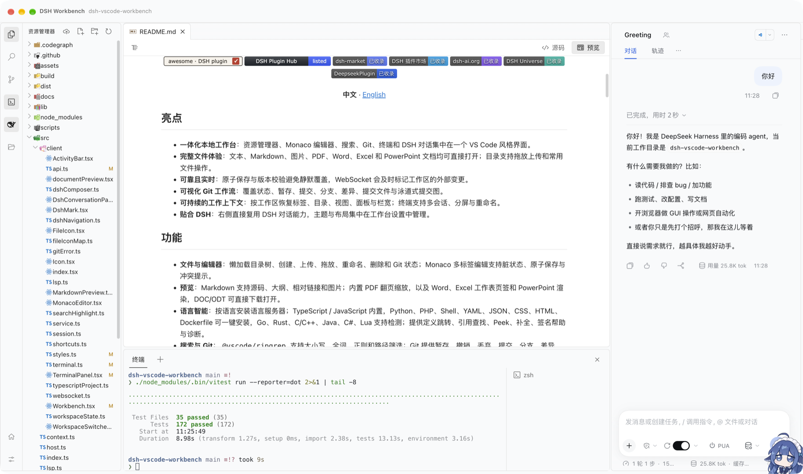
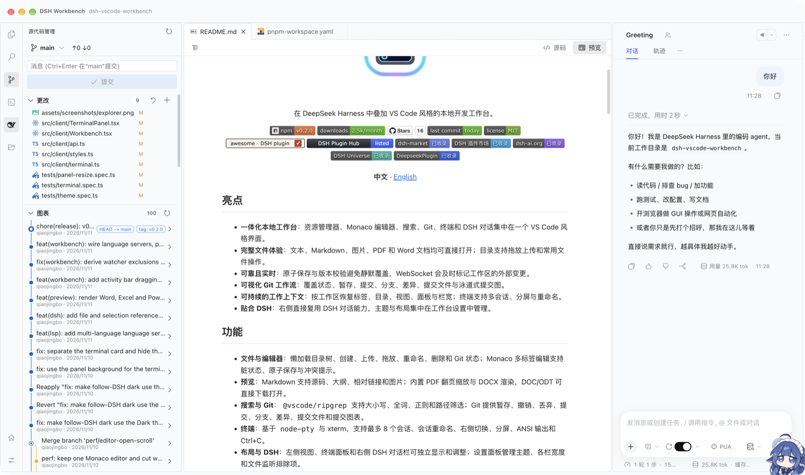

<h1 align="center">DSH VS Code Workbench</h1>

<p align="center">
  
</p>

<p align="center">在 DeepSeek Harness 中叠加 VS Code 风格的本地开发工作台。</p>

<p align="center">
  <a href="https://www.npmjs.com/package/dsh-vscode-workbench"></a>
  <a href="https://www.npmjs.com/package/dsh-vscode-workbench"></a>
  <a href="https://github.com/tingfeng347/dsh-vscode-workbench/stargazers"></a>
  <a href="https://github.com/tingfeng347/dsh-vscode-workbench/commits/main"></a>
  <a href="https://github.com/tingfeng347/dsh-vscode-workbench/blob/main/LICENSE"></a>
  <br>
  <a href="https://awesome-dsh-plugin.com/p/tingfeng347/dsh-vscode-workbench/"></a>
  <a href="https://dshpluginhub.ai/plugins/dsh-vscode-workbench"></a>
  <a href="https://dshmarket.com/p/tingfeng347/dsh-vscode-workbench/"></a>
  <a href="https://dshmk.com/plugins/1343926987"></a>
  <a href="https://dsh-ai.org/p/tingfeng347/dsh-vscode-workbench"></a>
  <a href="https://duink.com/plugins/1343926987/"></a>
  <a href="https://deepseekplugin.org/plugins/tingfeng347-dsh-vscode-workbench"></a>
</p>

<p align="center"><b>中文</b> · <a href="README.en.md">English</a></p>

## 亮点

- **一体化本地工作台**：资源管理器、Monaco 编辑器、搜索、Git、终端和 DSH 对话集中在一个 VS Code 风格界面。
- **完整文件体验**：文本、Markdown、图片、PDF 和 Word 文档均可直接打开；目录支持拖放上传和常用文件操作。
- **可靠且实时**：原子保存与版本校验避免静默覆盖，WebSocket 会及时标记工作区的外部变更。
- **可视化 Git 工作流**：覆盖状态、暂存、提交、分支、差异、提交文件与泳道式提交图。
- **可持续的工作上下文**：按工作区恢复标签、目录、视图、面板与栏宽；终端支持多会话、分屏与重命名。
- **贴合 DSH**：右侧直接复用 DSH 对话能力，主题与布局集中在工作台设置中管理。

## 功能

- **文件与编辑器**：懒加载目录树、创建、上传、拖放、重命名、删除和 Git 状态；Monaco 多标签编辑支持脏状态、原子保存与冲突提示。
- **预览**：Markdown 支持源码、大纲、相对链接和图片；内置 PDF 翻页缩放与 DOCX 渲染，DOC/ODT 可直接下载打开。
- **搜索与 Git**：`@vscode/ripgrep` 支持大小写、全词、正则和路径筛选；Git 提供暂存、撤销、丢弃、提交、分支、差异、提交文件和提交图表。
- **终端**：基于 `node-pty` 与 xterm，支持最多 8 个会话、会话重命名、右侧切换、分屏、ANSI 输出和 Ctrl+C。
- **布局与 DSH**：左侧视图、终端面板和右侧 DSH 对话栏可独立显示和调整；设置面板管理主题、各栏宽度和文件监听排除项。
- **同步与恢复**：工作区文件变化实时推送，默认跳过 `node_modules`、`vendor`、`third_party`、`build`、`dist` 等大目录，可在设置里追加排除项；刷新后恢复活动视图、标签、目录展开、面板和布局。

工作台通过官方 `sidebar.footer.action` 与 `shell.overlay` 扩展点挂载，不替换或卸载 `ui-layout`。

## 演示

<p align="center">
  
  <br><em>资源管理器与 Monaco 编辑器</em>
</p>

<p align="center">
  
  <br><em>源代码管理与提交图表</em>
</p>

<p align="center">
  
  <br><em>终端</em>
</p>


## 安装

插件 0.1.15 适配 DeepSeek Harness `0.2.2-rc.1`（Cordis `4.1.0`）。请先更新 Harness，再安装插件；旧版对应关系见下表。

```bash
npm i -g @deepseek-ai/dsh@0.2.2-rc.1
```

```bash
dsh plugin --profile web add dsh-vscode-workbench
```

通过 DSH 插件页或插件市场安装时，界面会把它加入 `dsh.profile.bundles` 并启用。用上面的 CLI 命令安装时只写入 `dependencies`，还需要在 `~/.dsh/profiles/web/package.json` 的 `dsh.profile.bundles` 中加入 `dsh-vscode-workbench`，然后重启 `dsh web`：

```json
{
  "dsh": {
    "profile": {
      "bundles": [
        "@deepseek-ai/dsh-base",
        "@deepseek-ai/dsh-web-app",
        "dsh-vscode-workbench"
      ]
    }
  }
}
```

### 首次安装终端支持

终端使用 `node-pty`。如果安装日志提示其构建脚本被阻止，在 DSH 所在机器的 `~/.dsh/profiles/web/pnpm-workspace.yaml` 中合并以下配置，保留已有设置：

```yaml
allowBuilds:
  node-pty: true
```

新版 Harness 可能回滚失败的安装，配置后应重新执行安装命令。若插件已安装但终端仍提示 `node-pty` 加载失败，可执行：

```bash
cd ~/.dsh/profiles/web
pnpm rebuild node-pty
```

刚发布不足 24 小时的版本可能被 pnpm 的安全等待期拦截。等待后重试即可；DSH 提供“立即更新”时可直接选择它。

### 从旧版升级

运行中的插件管理器启用 HMR 时，不允许覆盖安装同名包。先在插件管理器中移除旧版，再安装新版；CLI 可使用：

```bash
dsh plugin --profile web remove dsh-vscode-workbench
dsh plugin --profile web add dsh-vscode-workbench
```

完成后重新打开工作台，必要时重启 `dsh web` 并刷新页面。

### 安装失败：Harness 版本不兼容

如果安装只以这一行结束，说明 DSH 在安装前就拒绝了插件，pnpm 没有执行、也没有任何文件被写入：

```
dsh: plugin command failed; diagnostics: ~/.dsh/profiles/<profile>/.plugin-manager/logs/operation-*/pnpm.log
```

原因是 Harness 的兼容性预检：优先用插件的 `engines.dsh` 比对当前 Harness 版本；未声明时，检查所有 `@deepseek-ai/dsh*` peerDependencies。预发布版本也参与匹配，不满足就中止安装。诊断日志里能看到真正的结论：

```
dsh: installation rejected: Plugin dsh-vscode-workbench@<插件版本> is incompatible with dsh <Harness 版本>: peerDependencies {...}
dsh: nothing was installed.
```

插件市场把这类失败归入通用的 `plugin-side install failure`，所以自动提交的 Issue 里不会带上上面这行，正文只剩 `pnpm.log` 的路径。

| 插件版本 | 需要的 Harness |
| --- | --- |
| 0.1.15 | `0.2.2-rc.1`（Cordis `4.1.0`，默认基线）；另验证 `0.2.1-rc.5`（Cordis `4.0.5`） |
| 0.1.14 | `0.2.2-rc.1`（Cordis `4.1.0`，默认基线）；另验证 `0.2.1-rc.5`（Cordis `4.0.5`） |
| 0.1.12 | `0.2.1-rc.5`（Cordis `4.0.5`，默认基线）；另验证 `0.2.2-rc.1`（Cordis `4.1.0`，Node.js ≥24.9） |
| 0.1.11 | `0.2.1-rc.5`（Cordis `4.0.5`，默认基线）；另验证 `0.2.2-rc.1`（Cordis `4.1.0`，Node.js ≥24.9） |
| 0.1.10 | `0.2.1-rc.4`（Cordis `4.0.5`，旧版验证基线） |
| 0.1.9 | `0.2.1-alpha.3`（Cordis `4.0.5-alpha.2`，旧版验证基线） |
| 0.1.8 | `0.1.1-rc.2` |

Harness `0.2.0-rc.2` 上没有可用的插件版本：0.1.9 依赖 Harness `0.2.1-alpha.2` 才引入的 `workingDirectory` 服务，0.1.8 又只适配 `0.1.1-rc.2`。请先把 Harness 升级到 `0.2.2-rc.1` 再安装 0.1.15，例如 npm 全局安装时：

```bash
npm i -g @deepseek-ai/dsh@0.2.2-rc.1
```

`dsh plugin allow-version` 只跳过版本闸门，不会补上缺失的宿主服务，在 `0.2.0-rc.2` 上插件仍然加载不起来；请优先升级 Harness。

### 新版架构适配

0.1.11 将 DSH 开发依赖与 peerDependencies 同步至 `0.2.1-rc.5`，Cordis 保持 `4.0.5`，并显式声明 `engines.dsh`。同时显式声明 `0.2.2-rc.1` 的预发布依赖范围。安装版本闸门使用官方 `evaluatePluginCompatibility()` 验证，无需版本豁免。

两套依赖环境均通过类型检查、52 项测试及构建，覆盖官方版本闸门、真实 Harness cookie 认证与会话目录切换回归；尚未完成完整 DSH 页面端到端验证。next 渠道需 Node.js ≥24.9。

0.1.12 在此基础上集中修复可靠性与 macOS 使用问题：保留并恢复工作区草稿，加强并发保存和文件操作；补齐可拖动标题栏与窗口留白，修正活动工作台的 DSH 原生侧栏遮挡；WebSocket 地址跟随 DSH transport，终端启动时自动修复 `spawn-helper` 执行位。PDF、DOCX、图片和 Markdown 预览已在 DSH Desktop 中实际验证。

0.1.14 修复 Windows Desktop 的顶部叠字：DSH 0.2 的 Windows 自定义标题栏会在窗口顶部预留 40px，并绘制「应用」「编辑」菜单；工作台现在识别 `data-windows-titlebar`，从标题栏下沿开始布局，不再与「源代码管理」等侧栏标题重叠，同时保留标题栏的拖动区域。开发与测试基线同步升级到 Harness `0.2.2-rc.1` / Cordis `4.1.0`，并在 `0.2.1-rc.5` / Cordis `4.0.5` 上保留兼容范围。

0.1.14 同时处理大仓库与多标签场景：文件监听默认跳过 `vendor`、`third_party`/`third_part`、`build`、`dist`、`out`、`target`、`.venv`、`__pycache__` 等大目录，并允许在工作台设置里追加排除项；监听资源耗尽时只停用自动刷新，不再让 DSH 因 inotify 上限崩溃。标签栏改为单行省略并隐藏原生滚动条，关闭全部按钮固定右侧，切换标签时自动滚入可视区域。底部状态栏默认隐藏，可在设置中重新开启。

0.1.15 统一深色主题配色：活动栏、侧栏、标签栏、底部面板和状态栏统一为 `#191a1b`，编辑器为 `#121314`，输入框与浮层为 `#202122` / `#252526`，文本和强调色同步到同一套 VS Code 风格色板（`#bfbfbf` / `#8c8c8c` / `#6e6e6e`、`#307e9f`）；Monaco 与终端使用相同底色，深色状态栏不再单独使用蓝色背景。浅色主题同步 VS Code Light：侧栏和终端为 `#f8f8f8`、编辑器为 `#fff`、分隔线为 `#e5e5e5`，并为侧栏与编辑器、编辑器与终端之间加入分隔线和 8px 圆角。设置中新增「字体大小」（11–20px），同时作用于工作台界面、Monaco 编辑器和终端。DSH 对话栏在固定深色模式下也使用同一套底色。工作台入口移入 DSH 侧栏的面板列表（与「插件」「自动化任务」等并列），不再使用右下角悬浮按钮；DSH 对话栏的开关移到活动栏的鲸鱼图标，可随时打开或关闭。

- 客户端通过 `ui-renderer` 提供的槽位服务注册界面，使用 `ui-session` 的 `mainView` 引用选择当前会话；不再依赖已移除的 `dsh-client-runtime`。
- 文件、搜索、Git 和新建终端通过 `workingDirectory.get(session)` 使用会话当前目录，跟随工作目录投影切换；失效会话返回 404。
- HTTP 与 WebSocket 接口使用 `connection.requestRejection()`，共享 Harness 登录认证及 Host/Origin 校验；终端额外保留 loopback 限制。
- 对话栏按官方 `data-phase` 容器定位，支持新版 `conversation.content` 布局。

## 快捷键

| 快捷键 | 操作 |
| --- | --- |
| `Ctrl+Shift+E` | 打开资源管理器 |
| `Ctrl+Shift+F` | 打开搜索 |
| `Ctrl+Shift+G` | 打开源代码管理 |
| `Ctrl+S` | 保存当前文件 |
| `Ctrl+Alt+B` | 显示或隐藏 DSH 对话栏 |
| `Ctrl+\`` | 显示或隐藏终端 |
| `Ctrl+Shift+\`` | 新建终端 |

左侧活动栏的终端按钮可切换显示或隐藏终端面板。

## 安全

所有插件接口要求 Harness 登录认证。Host 只接受当前 DSH 会话工作目录内的相对路径，并阻止目录穿越与符号链接越界。保存使用版本校验与原子替换；Git 与 ripgrep 使用参数数组启动，不拼接 Shell 命令。终端只接受同源 loopback 请求，固定在创建时的会话工作目录启动，并移除 API key、token、secret 等敏感环境变量。

## 开发

```bash
pnpm install
pnpm typecheck
pnpm test
pnpm build
```

需要 Node.js `^22.19 || >=24`、pnpm 11.7、系统 Git，以及 `node-pty` 所需的本机构建环境（预编译产物不可用时）。

## 许可证

[MIT](LICENSE)
